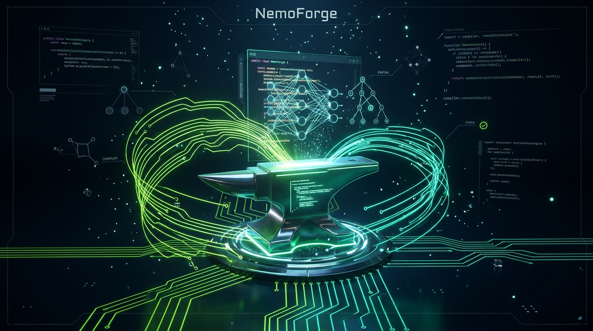

# ⚡ NemoForge: Autonomous SWE Agent

<p align="center">
  
</p>

> **Powered by NVIDIA Nemotron on Nebius Token Factory**  
> An autonomous software engineering agent that ingests Jira/Git issues, localizes target code via deterministic AST symbol graphs, performs surgical edits using NVIDIA Nemotron, and guarantees correctness through automated multi-tier verification gates.

[](https://nebius.com)
[](https://developer.nvidia.com)
[](LICENSE)

---

## 🌟 Overview

**NemoForge** is a production-grade autonomous software engineering platform submitted for the **Nebius x NVIDIA Global AI Hackathon** (*Coding and Agentic Engineering Track*).

Unlike superficial coding assistants that rely on fuzzy vector retrieval and prompt-and-pray patching, NemoForge merges **deterministic AST compilation & call-graph analysis** with **NVIDIA's flagship Nemotron reasoning models** hosted on **Nebius Token Factory**.

```
                      ┌──────────────────────────────────────────────┐
                      │    Ticket / Issue / Feature Description      │
                      └──────────────────────┬───────────────────────┘
                                             │
                                             ▼
                      ┌──────────────────────────────────────────────┐
                      │       Stage 1: Deterministic Discovery       │
                      │  (Tree-sitter AST Slicing + SQLite Symbols)  │
                      └──────────────────────┬───────────────────────┘
                                             │
                                             ▼
                      ┌──────────────────────────────────────────────┐
                      │    Stage 2: NVIDIA Nemotron Reasoning        │
                      │  (Nemotron 3 Super 120B MoE via Nebius API)  │
                      └──────────────────────┬───────────────────────┘
                                             │
                                             ▼
                      ┌──────────────────────────────────────────────┐
                      │        Stage 3: Surgical Patch Engine        │
                      │   (Fail-Closed 3-Line Anchor Replacements)   │
                      └──────────────────────┬───────────────────────┘
                                             │
                                             ▼
                      ┌──────────────────────────────────────────────┐
                      │     Stage 4: Two-Tier Verification Gate      │
                      │   (Maven/Gradle Compiler + Playwright E2E)   │
                      └──────────────────────────────────────────────┘
```

---

## ✨ Architectural Pillars

### 1. 🟢 NVIDIA Nemotron on Nebius Token Factory
- **Flagship Intelligence**: Utilizes **NVIDIA Nemotron 3 Super (120B MoE)** for deep architectural understanding, cross-microservice dependency navigation, and surgical code synthesis.
- **Fast Discovery**: Routes lightweight intake checks and log diagnosis to **NVIDIA Nemotron 70B Instruct**.
- **Nebius Token Factory Integration**: Native OpenAI-compatible client targeting `https://api.tokenfactory.nebius.com/v1/`.

### 2. ⚡ Zero-Database Fast Indexing (SQLite + Tree-sitter)
- Completely abandoned bloated graph databases (Neo4j) and vector search engines.
- Indexes 4,600+ multi-language files in **13.7 seconds flat** into local embedded SQLite (`.nemoforge/index.db`).
- Slices method boundaries, `@Autowired` dependencies, and class skeletons on-the-fly in 3ms.

### 3. 🔒 Zero-Leak Key Architecture
- API credentials are typed directly in the frontend UI (`⚙️ LLM Settings`) and stored exclusively in local untracked `.env.local`.
- Zero credentials are ever committed to Git or pushed to remote repositories.

### 4. 🛡️ Fail-Closed Surgical Patching & Verification
- Employs strict 3-line context anchors to eliminate silent hallucinations.
- Validates code changes with live build executions (`mvn compile`, `npm test`, Playwright DOM assertions) before marking any ticket complete.

---

## 🚀 Quick Start (1-Click Launch)

### Prerequisites
- **Python 3.10+** (Python 3.12 or 3.13 recommended)
- **Node.js 18+** & npm
- **Nebius Token Factory API Key** ([Get your key here](https://tokenfactory.nebius.com))

---

### Step 1: Clone the Repository
```bash
git clone https://github.com/DeepakMadgani/NemoForge.git
cd NemoForge
```

---

### Step 2: Run 1-Click Setup

#### On Windows:
Double-click **`setup.bat`** (or run in PowerShell/CMD):
```powershell
.\setup.bat
```

#### On Linux / macOS:
```bash
chmod +x setup.sh start.sh
./setup.sh
```

*This automatically provisions the Python virtual environment (`.venv`), installs all backend dependencies, and installs frontend npm packages.*

---

### Step 3: 1-Click Start

#### On Windows:
Double-click **`start.bat`** (or run in PowerShell/CMD):
```powershell
.\start.bat
```

#### On Linux / macOS:
```bash
./start.sh
```

*This automatically launches both:*
- **Backend API Server** on `http://localhost:8002`
- **Frontend Dashboard** on `http://localhost:3000`
- Automatically opens `http://localhost:3000` in your default browser!

---

### Step 4: Configure Nebius API Key in the UI
1. Once the dashboard opens at `http://localhost:3000`, click **⚙️ Settings** in the top navigation bar.
2. Enter your **Nebius Token Factory API Key** (`nebius-...`).
3. Select **NVIDIA Nemotron 3 Super (120B MoE)** or **NVIDIA Nemotron 70B Instruct**.
4. Click **Save & Test Connection**. You are ready to autonomously solve tickets!

---

## 🛠️ Tech Stack

| Component | Technology | Role |
| :--- | :--- | :--- |
| **Inference & Reasoning** | NVIDIA Nemotron 3 Super / 70B | Flagship code synthesis & architectural reasoning |
| **Hosting Infrastructure** | Nebius Token Factory | High-throughput serverless open-model inference |
| **AST Code Intelligence** | Tree-sitter & Embedded SQLite | Sub-millisecond syntax parsing & call graph indexing |
| **Backend API** | FastAPI & Uvicorn | Async WebSocket orchestration & workflow dispatch |
| **Frontend UI** | React, Vite & Vanilla CSS | Live streaming workflow monitor & human checkpoint gate |
| **Verification Gate** | Subprocess Sandbox & Playwright | Live polyglot compilation & E2E DOM verification |

---

## 📄 License
This project is licensed under the MIT License - see the [LICENSE](LICENSE) file for details.
